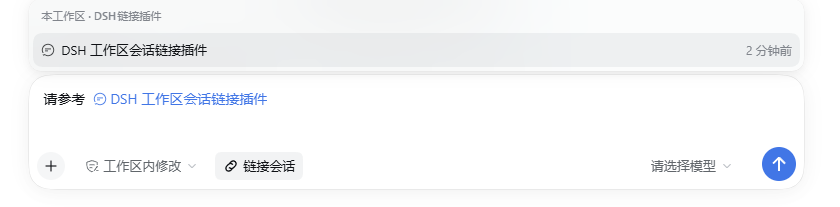

# DSH 工作区会话链接插件

[](https://github.com/qiaoyuzhou/dsh-workspace-session-link/actions/workflows/test.yml)

在 DSH 输入框里放一个「链接会话」按钮：写任务时点一下，只列出**当前工作区**里的其他会话，选中后插入一个会话引用 chip。发送时 DSH 自带的 `session-reference` 服务会把被引用会话的只读快照作为跨会话上下文交给模型，让模型在写这个工作区的任务时参考之前的会话。

这里的“工作区”指 DSH 侧边栏里的工作区分组，不要求两个会话的 `cwd` 完全相等：只要会话属于同一个工作区，即使它是在工作区的子目录里启动的，也会出现在菜单里。



## 它解决什么

- 工作区里文件很多、会话也很多时，不用离开当前会话去翻历史。
- 只显示当前工作区分组里的会话，避免误引用其他项目的会话。
- 插入的是 DSH 原生 `dsh-session:` 引用，不是复制粘贴：模型收到的是带来源和「不可信背景」警告的快照。
- 不重复实现 Host 逻辑，完全复用官方 `@deepseek-ai/dsh-session-reference`。

## 使用

1. 安装并重启 DSH（见下方）。
2. 打开任意会话，在输入框左下方点「链接会话」。
3. 菜单只列出当前工作区的其他会话；可上下键选择，Enter 插入，Esc 关闭。
4. 会话标题会以一个会话 chip 的形式出现在草稿中；继续输入并发送即可。

如果当前工作区只有这一个会话，菜单会显示「本工作区暂无其他会话」。

## 安装

### 从 GitHub 安装

```powershell
& "$env:LOCALAPPDATA\Programs\DeepSeek Harness\resources\runtime\cli\bin\dsh.cmd" plugin --profile desktop add github:qiaoyuzhou/dsh-workspace-session-link
```

### 从本地目录安装

Desktop 的 `desktop` profile 只允许 Desktop 随附的 `dsh.cmd` 管理；npm 版 `dsh` 会拒绝管理该 profile。因此使用安装目录下的命令：

```powershell
& "$env:LOCALAPPDATA\Programs\DeepSeek Harness\resources\runtime\cli\bin\dsh.cmd" plugin --profile desktop add link:C:\path\to\dsh-workspace-session-link
```

安装完成后重启 DSH。重启后可在侧边栏「插件」页确认 `dsh-workspace-session-link` 已启用。

卸载：

```powershell
& "$env:LOCALAPPDATA\Programs\DeepSeek Harness\resources\runtime\cli\bin\dsh.cmd" plugin --profile desktop remove dsh-workspace-session-link
```

## 从源码开发

```powershell
git clone https://github.com/qiaoyuzhou/dsh-workspace-session-link.git
cd dsh-workspace-session-link
node --test test/smoke.test.mjs
```

用本地目录安装时，把上面的 `C:\path\to\dsh-workspace-session-link` 换成克隆目录的绝对路径。仓库没有构建步骤，GitHub 上的 `lib/` 就是可直接加载的产物。

## 兼容性

- DSH `0.2.1-rc.3`（当前 Desktop 运行时）。
- 依赖的官方包：`dsh-client-ui-conversation`、`dsh-client-ui-input-trigger`、`dsh-api-workspace-controller`、`dsh-session-reference`。这些是 Web bundle 自带的客户端/Host 包，插件本身不额外安装运行时依赖。
- 只支持 Web/Desktop 客户端；headless 等没有 composer 的运行面不会显示按钮，但 package 仍可加载。

## 实现

- `lib/index.js`：空 Host 入口，使插件进入 Host 配置树，从而让 Web bundle 扫描到 `dsh.client`。
- `lib/client.js`：注册 `conversation.input.left` 按钮和一个只读 `@` 触发源。
  - 通过 `workspaces.list` 找到当前会话所属的工作区，再用工作区的 `sessionIds` 过滤候选；
  - 无法确定工作区归属时回退到官方候选的 `sameWorkspace`（cwd 相同）；
  - 按会话列表的 `updatedAt` 倒序排列；
  - 选中后交给 `inputTriggers` 的标准插入管线，生成真正的会话 chip；
  - chip 的序列化形式是官方 `@[标题](dsh-session:...)` mention。
- 没有复制官方 `dsh-client-ui-reference` 的文件/目录逻辑，也没有修改 Host 的 session-reference 服务。

## 开发与验证

没有构建步骤；`lib/client.js` 是可直接加载的 `window.__ModuleLoader__` bundle。

```powershell
node test/smoke.test.mjs
```

测试覆盖工作区成员过滤、按更新时间排序、空状态、会话 mention 的插入形状以及按钮 slot 注册。

## 已知边界

- 单条消息最多引用 3 个会话（官方 `session-reference` 的硬限制）；菜单一次插入一个，可重复点击。
- 只按会话元数据（标题、工作目录）发现，不搜索消息正文。
- 引用是发送时的快照，不是实时订阅。
